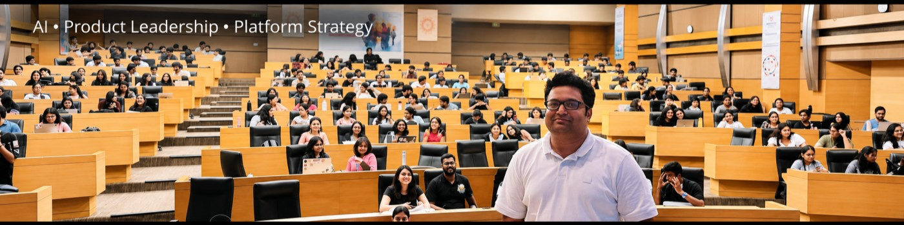

  

# Hi, I'm Pavan 👋

I'm a product manager who ships — at work and on weekends.

By day, I'm a **Lead Product Manager at Thomson Reuters**, owning MCP connectivity and marketplace distribution for CoCounsel's Transactional Experience. I launched TR's first MCP server (the first for a legal collaboration platform) and lead HighQ's launches across the major AI platforms. By night, I build open-source MCP servers and Claude plugins solo, and vibe-code MVPs to understand problems first-hand: idea → live in days, not quarters.

I think the next generation of PMs will prototype, build, and ship the way engineers do. I call this **Product 3.0**: Feature Factory → Data-Driven → AI-Native.

## 💼 What I'm building at work

I own the integration layer that connects legal systems of record inbound to CoCounsel, and exposes trusted matter context outbound to AI agents. I work with 16 engineers, from requirements through GTM, customer enablement, security and compliance review, and live demos.

- **HighQ MCP Server** — TR's first MCP server. Gives agents governed access to matter context: workspaces, structured data, documents and activity history, across MCP-compatible agents.
- **Launch partnerships** — HighQ shipped as a launch connector or plugin on three major AI platforms:
  - **Gemini Enterprise for Legal** (Aug 2026, preview): [Google Cloud announcement](https://cloud.google.com/blog/products/ai-machine-learning/introducing-gemini-enterprise-for-legal/) · [Thomson Reuters post](https://www.thomsonreuters.com/en-us/posts/innovation/thomson-reuters-and-google-cloud-bringing-trusted-matter-context-to-gemini-enterprise-for-legal/)
  - **OpenAI Astra for Law** (Sep 2026, ChatGPT Enterprise): [OpenAI announcement](https://openai.com/index/astra-for-law/) · [Thomson Reuters post](https://www.thomsonreuters.com/en-us/posts/innovation/thomson-reuters-and-openai-advancing-an-open-ecosystem-for-legal-ai/)
  - **Microsoft Copilot for Legal** (Oct 2026): [Microsoft announcement](https://techcommunity.microsoft.com/blog/microsoft-copilot-blog/introducing-microsoft-copilot-for-legal/4564246)
  - HighQ MCP also works with Claude Desktop and Claude Code: [overview](https://legal.thomsonreuters.com/blog/delivering-the-future-of-legal-services-with-highq-and-cocounsel/)
- **Native AI agent for legal collaboration** — led the build of an agent that takes a task and does the work across documents, matters and audit trails, with grounded, cited, permission-aware output.
- **Experimentation** — led the Split.io integration and experimentation program at TR, enabling data-driven feature releases.

## 🌐 Open source: GlobalPulse MCP

**[GlobalPulse MCP](https://github.com/gpavan1992/Globalpulse-MCP)** — Live public data for your AI assistant. 11 read-only tools over World Bank macroeconomics, UN GDACS disaster alerts, Open-Meteo weather and climate, UN Comtrade bilateral trade flows, live flight tracking and country profiles. Every number traceable to its source, no API keys, no subscriptions. Listed on the MCP Registry and on npm (`globalpulse-mcp-server`), hosted over Streamable HTTP, and in review for the ChatGPT and Claude directories.

## 🇮🇳 Claude plugins: Artha and PWP

- **[Artha](https://github.com/gpavan1992/artha-skill)** — Open-source Claude plugin with 8 skills for Indian investors: portfolio X-ray, tax, fund overlap, screening and more. Built on public data, no hosted backend, and it flags the traps in Indian market data (bonus/split EPS, one-off profits) instead of hiding them.
- **PWP (Project Workflow Protocol)** — Claude plugin, live in the Claude plugin directory. Enforces plan → execute → verify → ship, so AI proposes and you decide before any code gets written.

## 🇮🇳 Open source: Bharat MCP

**Bharat MCP** — An MCP server wrapping India's public API infrastructure. 17 tools that give any AI agent instant access to government data: PIN codes, GSTIN, mandi prices, AQI, train schedules, CGHS hospitals, fuel prices and more. India's DPI, AI-agent ready.

## 🩺 Open source: Nota Health

**[Nota Health](https://github.com/gpavan1992/nota-health)** — Open-source AI for clinical documentation: prior authorizations, discharge summaries, insurance appeals, referral letters. Self-hostable, AGPL-3.0. Built for the half of a physician's day not spent with patients.

[Live demo →](https://nota-health-hub-ai.lovable.app/)

## MVPs I've shipped solo

Each one started with a real problem worth solving:

- **[PositionIQ](https://positioniq-tax-advocate.lovable.app)** — Tax risk brief generator. Closes the gap between tax research and the structured brief a partner or CFO actually needs.
- **[SynergyFlow](https://synergyflow-nocode-demo.vercel.app/)** — Full-stack CRM. A study in how far solo + AI can take you on workflow software.
- **[ApnaSaathi](https://saathi1.lovable.app/)** — AI medical second-opinion companion. Built to explore what trustworthy health AI looks like for Indian families.

## Teaching & writing

- **Frameworks I teach:** CSCQSM (structured prompting for builders), Product 3.0 (the AI-native PM playbook)
- **Guest speaker:** IIM Udaipur, IIM Raipur, MDI Gurgaon, Mahindra University, Arizona State University, Johns Hopkins University
- **Workshops:** GrowthX, Product Folks, Masters' Union: hands-on AI product building and rapid prototyping for practising PMs and founders
- **Recognition:** Anthropic Builder Summit (250 invited builders, Feb 2026), winner of the TR Global AI Hackathon
- **Writing:** a build-in-public series on [LinkedIn](https://www.linkedin.com/in/pavan-kumar-galiveeti-a44335192/) and [Medium](https://medium.com/@gpavancitizen) on MCP, prototyping and AI governance

## About me

- Lead Product Manager at **Thomson Reuters**, working on Legal AI since 2024
- 9+ years across legal tech, iGaming, fintech and travel — engineer turned PM
- Previously at Entain (onboarding and identity verification across 120+ brands), Rehlat and Airtel Payments Bank
- Young India Fellow, Ashoka University

---

🌱 Building something in AI agents, MCP, or AI-native products? Or a PM making the leap from spec-writing to shipping? Happy to swap notes.
